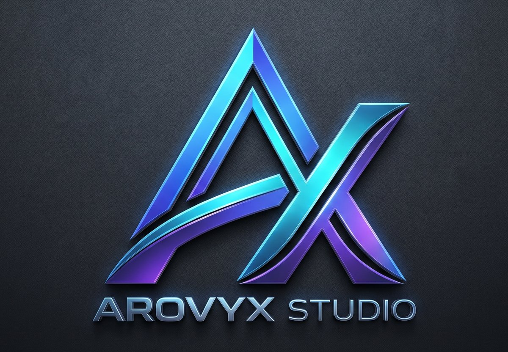

<p align="center">
  
</p>

# Arovyx Studio

An AI-powered developer portfolio for showcasing **apps, games, packages and plugins**.

Paste a link (GitHub/GitLab repo, npm or PyPI package, Play Store, itch.io, Steam or any website) into the hidden admin panel. The server fetches the page, sends it to the **NVIDIA NIM** API, and fills in every project field: title, descriptions, category, tags, tech stack, features, status and version. You review and edit the draft, save it, and it's live for visitors immediately.

Visitors browse read-only; there are no public accounts.

**Live site:** <https://arovyx-studio.vercel.app> · **Admin:** <https://arovyx-studio.vercel.app/studio> (see [Live deployment](#live-deployment))

---

## Stack

- **Next.js 14** (App Router) · **React 18** · **TypeScript** (strict)
- **Tailwind CSS**: custom components only (no UI library)
- **Motion** (`motion/react`) + **Lenis** smooth scrolling for the public site's animations. Shared pieces live in `src/components/motion/`: `Reveal` / `Stagger` scroll reveals, `SplitText` word-by-word headings, `Marquee`, `Parallax`, `TiltCard`, `Magnetic`, `AnimatedTabs` and `ScrollProgress`. Variants and easings are in `src/lib/motion.ts`. All of it respects `prefers-reduced-motion`, and `/studio` loads none of it.
- **Prisma + PostgreSQL** (hosted on **Neon**, free tier)
- Hosting on **Vercel**, deployed by **GitHub Actions** on every merge to `master`
- **NVIDIA NIM** (OpenAI-compatible `chat/completions`, called with plain `fetch`)
- **Zod** validation · **lucide-react** icons · **react-hot-toast**

---

## Quick start

Requires **Node.js 18.17+** and a **PostgreSQL** connection string. The easiest source is a free Neon database; see [Local development against Neon](#local-development-against-neon).

```bash
cp .env.example .env        # then fill in the values (see below)
npm install
npx prisma db push
npm run dev
```

Open <http://localhost:3000>.

The first `npm run dev` seeds a fresh database automatically (production is seeded by the deploy workflow): 3 example projects (an app, a game and a package) plus default site settings. On later runs the seed sees existing data and skips, so your edits are never overwritten. Run `npm run db:seed` to force a re-seed (it upserts the example projects again).

### Production

```bash
npm run build
npm start
```

> **Rebuild after changing `.env`.** Next.js reads environment values at build time for production builds. If you edit `.env` and only restart `npm start`, the old values stay in effect.

---

## Environment variables

| Variable | Required | Description |
| --- | --- | --- |
| `NVIDIA_NIM_API_KEY` | for AI features | Your NIM key. Read **only on the server**, never sent to the browser. Without it, AI requests return a clear "missing key" error, and manual add/edit still works. |
| `NVIDIA_NIM_API_KEY_2` | no | Backup NIM key. A request switches to it at once when the first key answers 429, 401 or 403, and the refused key is passed over for 60 s. |
| `NVIDIA_NIM_MODEL` | no | Chat model id. Default `meta/llama-3.2-11b-vision-instruct` (see the model note below). |
| `NVIDIA_NIM_BASE_URL` | no | Default `https://integrate.api.nvidia.com/v1`. |
| `ADMIN_SECRET_KEY` | **yes** | The password for the hidden admin panel. |
| `ADMIN_JWT_SECRET` | **yes** | Random string used to sign the admin session cookie (HMAC-SHA256). |
| `NEXT_PUBLIC_SITE_URL` | yes | Public base URL, used for canonical/Open Graph URLs, the sitemap and robots. |
| `DATABASE_URL` | yes | PostgreSQL **pooled** connection string (Neon host contains `-pooler`). Used by the app at runtime. |
| `DIRECT_URL` | yes | PostgreSQL **direct** (non-pooled) connection string. Used by `prisma db push`. |
| `QUIZMASTER_FIREBASE_SERVICE_ACCOUNT` | for Quiz Master | Firebase Admin SDK key JSON of the Quiz Master project, **on one line** (Firestore, FCM, Auth and Remote Config). Server-only. Without it, Studio → Quiz Master only does dry runs. |
| `QUIZMASTER_FIREBASE_PROJECT_ID` | no | Default: the key's `project_id` (`quizmaster-3be48`). |
| `QUIZMASTER_GEN_MODEL` | no | First-choice NIM model that writes questions and push texts. Default `nvidia/nemotron-3.5-lightning-30b-a3b`. |
| `QUIZMASTER_VERIFY_MODEL` | no | First-choice NIM model that cross-checks answers. **Must be a different model family** from the generator. Default `mistralai/mistral-large-4-1t-a52b`, asked together with `google/gemma-4-31b-it`; the first answer wins. |
| `QUIZMASTER_TRANSLATE_MODEL` | no | First-choice NIM model for the Hindi and Hinglish versions. Default `nvidia/nemotron-3.5-lightning-30b-a3b`. If a model errors or hasn't answered after 45 s, a call also asks the next in `MODEL_POOL` (`src/lib/quizmaster/nimClient.ts`) and takes the first answer; the verifier never uses a family that wrote the questions. |
| `COLORTAP_FIREBASE_SERVICE_ACCOUNT` | for Color Tap | Firebase Admin SDK key JSON of the Color Tap project (`color-tap-c06bf`), **on one line**, with the Firebase Authentication Admin role. Server-only. A key for any other project is refused. Without it, Studio → Color Tap can't run. |

Generate a strong JWT secret with:

```bash
node -e "console.log(require('crypto').randomBytes(32).toString('hex'))"
```

---

## Getting a free NVIDIA NIM API key

1. Go to **[build.nvidia.com](https://build.nvidia.com)** and sign in (or create a free NVIDIA account).
2. Open any model page, for example a Llama chat model.
3. Click **"Get API Key"** and then **Generate Key**. Copy the key (it starts with `nvapi-`).
4. Paste it into `.env` as `NVIDIA_NIM_API_KEY="nvapi-…"` and restart (or rebuild for production).

**Model note:** the original spec's default, `meta/llama-3.3-70b-instruct`, has been **retired** by NVIDIA (it returns `410 Gone`). Hosted keys can also only call the models they're entitled to; others return `404`. This project defaults to `meta/llama-3.2-11b-vision-instruct`. To switch, pick a chat model from the catalog that your key can call and set `NVIDIA_NIM_MODEL`.

Hosted models can be slow or briefly unavailable. Requests time out after 60 s, retry twice on `429`/`5xx`, and the admin UI shows the error with a **Retry** button.

---

## Admin access (hidden)

The admin panel isn't linked anywhere on the public site. To open it:

- go to **`/studio`** directly, or
- press **`Ctrl + Shift + A`** (`Cmd + Shift + A` on macOS) on any page.

Sign in with the value of `ADMIN_SECRET_KEY`. The session is an HTTP-only signed cookie valid for **12 hours**.

**On the live site** that's <https://arovyx-studio.vercel.app/studio>, and the key is the `ADMIN_SECRET_KEY` **GitHub secret** you chose. See [Admin access on the live site](#admin-access-on-the-live-site) for how to change it.

**Changing the admin key locally:** edit `ADMIN_SECRET_KEY` in `.env` and restart (`npm run dev`), or rebuild and restart in production. To also invalidate all existing sessions immediately, change `ADMIN_JWT_SECRET` at the same time. Sessions are stateless, so logging out clears the cookie in that browser, and a copied token stays valid until it expires unless the JWT secret changes.

---

## Features

### Public site
- **Home:** hero with typing tagline, live stats strip, featured projects, category tiles, then the About and Contact sections. The navbar's About / Contact links smooth-scroll to them (and highlight the section in view); the old `/about` and `/contact` URLs redirect there.
- **`/projects`:** category tabs and search (title, tag, tech) synced to `?category=&q=`
- **`/projects/[slug]`:** full detail (markdown), features, tech stack, source/demo buttons, similar projects, per-project SEO and Open Graph. When set, it also shows an **app icon** and **"by {publisher}"** beside the title, the **feature graphic** as a banner above it, and a scrollable **screenshot gallery**. **Similar projects** lists only genuinely related work (same publisher, shared title words or tags, or 2+ shared tech-stack items) and is hidden when nothing is related. Play Store projects get a **"Get it on Google Play"** button; without media those parts simply don't render.
- **About** (home page section `#about`): bio, avatar, résumé link, tech arsenal, shipped timeline
- **Contact** (home page section `#contact`): form (validated and rate-limited, 5 per 10 min per IP), plus email/GitHub/LinkedIn/Instagram cards with copy-email. After a submission the server saves the message and returns a confirmation shown on the page; no email is sent.
- Dark theme by default with a light/dark toggle (remembered, synced across tabs), custom 404, skip link, keyboard-friendly menus, `sitemap.xml`, `robots.txt` and a default social card at `/og`

### Admin panel (`/studio`)
- **Overview:** project counts per category (live/draft), unread messages, AI jobs in the last 30 days with success rate, recent AI jobs (with errors), recently updated projects
- **Add Project (AI auto-fill):**
  - paste a URL and choose a category (or **AUTO**) to get an editable preview
  - **Google Play links** also bring in the **app icon**, **feature graphic** and up to 8 **phone screenshots**, plus the install count and **publisher**, read from the store page itself (never invented by the AI). GitHub/GitLab/npm/PyPI links fill **Published by** too (owner / author). All of it stays editable under **Media** in the form, and you can fill Media by hand for any project.
  - **Regenerate** re-runs the AI on the *same* fetched data, with an optional extra instruction (e.g. "make it more playful")
  - **Bulk mode:** one URL per line, processed in sequence with per-URL progress, each saved as a draft
  - **Manual add** without AI
- **Projects:** search, publish/unpublish, edit (same form, with the **AI Description Improver**), delete
- **Messages:** inbox with read/unread, detail view, reply by email, delete
- **Quiz Master:** runs the Quiz Master Android app's server jobs (question bank, daily quiz, pushes, weekly summary, guest cleanup) from a countdown in the tab. See [Quiz Master automation](#quiz-master-automation).
- **Color Tap:** deletes the Color Tap game's stale guest accounts from Firebase Auth. See [Color Tap guest cleanup](#color-tap-guest-cleanup).
- **Settings:** site name, owner name, tagline, bio, email, socials, avatar and résumé, live on the public site as soon as you save. **Hero showcase:** pick up to 3 projects (and their order) for the floating cards beside the home page title; with none picked, the latest 3 published are shown. **Featured projects:** pick up to 6 projects (and their order) for the home page grid; with none picked, the 6 newest published are shown.

Every AI call (generate or improve, success or failure) is logged to the `AiLog` table and shown on Overview.

---

## API

All `/api/admin/*` routes require the admin session cookie (checked by middleware and again in each handler) and validate bodies with Zod. Errors use one shape: `{ ok: false, error, details? }`.

| Method | Route | Purpose |
| --- | --- | --- |
| `POST` | `/api/admin/login` | Verify the admin key (constant-time compare, rate-limited) and set the cookie |
| `POST` | `/api/admin/logout` | Clear the cookie |
| `GET` / `POST` | `/api/admin/projects` | List all projects (incl. drafts) / create |
| `GET` / `PATCH` / `DELETE` | `/api/admin/projects/[id]` | Read / partial update / delete |
| `POST` | `/api/admin/ai/generate` | `{ url, category?, extraInstruction?, fetchedData? }` → fetch + NIM pipeline |
| `POST` | `/api/admin/ai/improve` | AI Description Improver |
| `GET` / `PATCH` | `/api/admin/settings` | Site settings |
| `GET` / `DELETE` | `/api/admin/messages` | Inbox (+ unread count) / bulk delete `{ ids: [...] }` |
| `PATCH` / `DELETE` | `/api/admin/messages/[id]` | Mark read/unread / delete one |
| `GET` / `PATCH` | `/api/admin/quizmaster/schedule` | Countdown, env check, active and recent runs / pause, resume, reset, interval (11–12 h), next run time |
| `GET` / `POST` | `/api/admin/quizmaster/runs` | Run history / start a run (scheduled, manual question bank or seed, guest cleanup); 409 while another run holds the lock |
| `GET` | `/api/admin/quizmaster/runs/[id]` | Run, steps and log lines (`?after=` for new ones) |
| `POST` | `/api/admin/quizmaster/runs/[id]/tick` | One bounded slice of work (≤ 240 s); returns `{ status, progress, done }` |
| `POST` | `/api/admin/quizmaster/runs/[id]/cancel` | Cancel a running run |
| `GET` / `PATCH` | `/api/admin/colortap/status` | Settings, key check, active and recent runs / automatic cleanup on or off, inactivity window (at least 30 days) |
| `POST` | `/api/admin/colortap/runs` | Start a run (automatic when due, or a manual cleanup, dry run by default); 409 while another run holds the lock |
| `GET` | `/api/admin/colortap/runs/[id]` | Run and log lines (`?after=` for new ones) |
| `POST` | `/api/admin/colortap/runs/[id]/tick` | One bounded slice of work (≤ 240 s); returns `{ status, done, pages, counts }` |
| `POST` | `/api/admin/colortap/runs/[id]/cancel` | Cancel a running run |
| `POST` | `/api/contact` | Public contact form |
| `GET` | `/api/projects` | Public list, `?category=&q=` (drafts only for admins) |

---

## Scripts

| Script | What it does |
| --- | --- |
| `npm run dev` | Dev server (seeds a fresh DB first) |
| `npm run build` | Production build |
| `npm start` | Serve the build |
| `npm run typecheck` | `tsc --noEmit` (strict) |
| `npm test` | Vitest: the Quiz Master ports and engine tests |
| `npm run db:push` | Apply the Prisma schema to the database |
| `npm run db:generate` | Regenerate the Prisma client |
| `npm run db:seed` | Seed / re-seed the example data |

---

## Project structure

```
prisma/
  schema.prisma        Project, ContactMessage, SiteConfig, AiLog, QuizSchedule, QuizRun, QuizRunStep, QuizLog
  seed.ts              example data (--if-empty used by predev and the deploy workflow)
.github/workflows/
  deploy.yml           merge to master → typecheck → sync secrets → Neon schema/seed → Vercel deploy
src/
  app/
    (public)/          home, projects, projects/[slug], about, contact
    studio/            login page + (panel)/ overview, projects, add, messages, quizmaster, settings
    api/               routes listed above
    og/route.tsx       default social card
    layout.tsx, not-found.tsx, sitemap.ts, robots.ts, globals.css
  components/          Navbar, Footer, Hero, ProjectCard, badges, ThemeToggle, …
    studio/            StudioShell, AiGeneratePanel, ProjectForm, MessagesInbox, SettingsForm, …
      quizmaster/      the Quiz Master tab: stopwatch, run driver, forms, run history
  lib/
    fetchers.ts        GitHub/GitLab/npm/PyPI APIs + generic HTML extraction
    nim.ts             nimChat (timeout + retries), generateProjectDetails, improveDescription, AiLog
    auth.ts            HMAC-signed sessions, constant-time key check (Edge-safe)
    session.ts         cookie helpers for server code
    validators.ts      Zod schemas + DB ↔ DTO mappers
    db.ts, projects.ts, dashboard.ts, seo.ts, slug.ts, api.ts, utils.ts, markdown.ts
    quizmaster/        server-only port of the Quiz Master jobs + the step engine (tests in __tests__/)
      assets/          prompts, push templates and the 405-group seed bank, copied verbatim
  middleware.ts        protects /studio/* and /api/admin/*
```

---

## Quiz Master automation

Studio → **Quiz Master** runs the server jobs of the Quiz Master Android app (Firebase project `quizmaster-3be48`). They used to run as Python on GitHub Actions in the quizmaster repo (`automation/`, `tool/cleanup_guests.py`). The TypeScript port in `src/lib/quizmaster/` writes byte-for-byte the same Firestore docs (packed `question_files/base_*`, `meta/questions`, `daily_challenges/{date}`, `question_pushes/*`) and FCM pushes, so the shipped app needs no update.

**How it runs.** Nothing external starts it: no GitHub Actions job, no Vercel Cron. The tab shows a countdown to `nextRunAt` (stored in `QuizSchedule`, so every tab and device shows the same one). The interval is 11–12 h, 12 h by default. When it reaches zero **while the tab is open**, or is already past when you open it (shown as *Overdue*), the page starts the run and drives it to the end; then the countdown restarts from the interval. Keep the tab open on a spare device, or press **Run now**, which can run any number of times a day: each click gets its own `x{time}` slot, so it writes new questions and sends the push (unless that run has just sent the daily quiz push). The timer keeps one run per `am` or `pm` slot. Line the timer up with about **07:00 IST**: the daily quiz is only published by a run that reaches its daily-quiz step before 12:00 IST, and a run from 15:00 IST on is the `pm` slot.

**Resumable steps.** A full run took up to ~40 minutes, but a Vercel function stops after ~5. So a run is a list of steps in Postgres (`QuizRun`, `QuizRunStep`, `QuizLog`), and `POST …/runs/{id}/tick` does as much as fits in **240 s**, saving after every unit:

- per category, up to 3 at once: prepare, generate (per difficulty), verify (12 questions per unit), up to 2 refill rounds, translate `hi` then `hi-Latn` (6 per unit, one retry), write
- then publish, the daily quiz (not on the `pm` slot), notify (and the weekly summary on Mondays), and guest cleanup (an automatic run, at most once every 24 h, one page of 1,000 users per unit)

A category that fails is recorded and doesn't stop the others. Publish always runs after the categories. If the tab closes mid-run, the run waits and the next tick, from any tab, carries on from the saved step.

**Locks.** There is one active run per kind, held by a lease (`lockedUntil`, renewed every tick, expires 10 minutes after the last one). A per-run tick lease (`tickUntil`) means two tabs never run the same step. The Firestore-side checks from the Python code are still there as a safety net: a slot already done is skipped, `daily_challenges/{date}` is only ever created, and pushes already recorded are never resent.

**Manual runs** use the old workflow inputs: slot (`extra` adds its own 45 per category), date, force, dry run, mode (`seed` needs typing SEED), and a category filter. A **dry run** reads the real data and logs every write and push instead of making them (FCM still validates the pushes). Guest cleanup has its own form; it is a dry run by default and never takes fewer than 30 days.

---

## Color Tap guest cleanup

Studio → **Color Tap** deletes stale guest accounts from the Firebase Auth of the Color Tap game (project `color-tap-c06bf`). It used to be a daily GitHub Actions job in the color_tap repo (`tool/cleanup_guests.py`). The code is self-contained: `src/lib/colortap/`, `src/components/studio/colortap/` and the `ColorTap*` tables share nothing with Quiz Master.

**What it deletes.** A guest has no sign-in provider, email or phone. It is stale when its newest activity (creation, last sign-in or last token refresh, which the game updates on every launch) is older than the window: 90 days by default, never fewer than 30. Registered accounts are never touched. Guests own no Firestore data, so only the Auth record goes.

**How it runs.** Nothing external starts it: no GitHub Actions job, no Vercel Cron. With **Automatic cleanup** on, opening the tab starts a run when the last real cleanup is over 24 hours old, and an open tab checks again every minute. If nobody opens the tab, nothing runs until the next visit. A failed or cancelled automatic run waits an hour before the next try. Automatic cleanup starts **off**, so check a dry run's counts before turning it on. The form runs a cleanup by hand; it is a dry run by default.

**Resumable.** A run handles one page of 1,000 users at a time and saves after each, with `POST …/runs/{id}/tick` doing as much as fits in **240 s**. If the tab closes, the next visit carries on from the saved page. A page is tried up to 3 times. There is one active run at a time, held by a lease that expires 10 minutes after the last tick. Runs are kept for 60 days.

**Setup.** In the `color-tap-c06bf` project, create a service account with the **Firebase Authentication Admin** role, then `jq -c . key.json | gh secret set COLORTAP_FIREBASE_SERVICE_ACCOUNT` and redeploy. The deploy fails if the key is for another project.

---

## Live deployment

The live site runs on **Vercel** (hosting + serverless functions) with a **Neon** PostgreSQL database (free tier), both linked to the Vercel account behind this repo. **Every merge (or push) to `master` deploys automatically** via GitHub Actions. You never deploy by hand.

| | |
| --- | --- |
| Live site | <https://arovyx-studio.vercel.app> |
| Admin panel | <https://arovyx-studio.vercel.app/studio> (or `Ctrl/Cmd + Shift + A` on any page) |
| Deploy workflow | `.github/workflows/deploy.yml` → repo **Actions** tab → "Deploy to Vercel" |
| Database | Neon project `arovyx-db`, managed from the Vercel dashboard → project **arovyx-studio** → **Storage** |

> **Why not GitHub Pages?** Pages only serves static files. This app needs a server for the `/studio` login, the API routes, the NVIDIA NIM calls (the API key must stay server-side) and the database, so it's hosted on Vercel, which runs Next.js natively.

### How a deploy works

```
merge PR → master
   │
   ▼
GitHub Actions: "Deploy to Vercel"
   ├─ check   npm ci → typecheck → prisma validate
   └─ deploy  1. verify every required secret exists
              2. sync GitHub Secrets → Vercel runtime env
              3. prisma db push   (apply schema to Neon; refuses destructive changes)
              4. seed --if-empty  (only fills an empty database)
              5. vercel pull → vercel build --prod → vercel deploy --prebuilt --prod
              6. smoke test: /, /projects, /api/projects, /robots.txt, /sitemap.xml, /studio → 200;
                 /studio/overview (logged out) → 307
```

GitHub Secrets are the single source of truth. Change a value there, re-run the workflow, and it's live. Vercel's own Git auto-deploy is turned off for this project, so each merge deploys exactly once. Runs never overlap (`concurrency: production`). The deployed URL appears on the run summary and on the repo's **Environments → production** panel.

**Redeploy without a code change** (e.g. after changing a secret):
- GitHub → **Actions** → **Deploy to Vercel** → **Run workflow** (branch `master`), or
- `gh workflow run deploy.yml --repo rsagar024/arovyx_studio`, then `gh run watch`

### Secrets & variables

Stored in GitHub → repo **Settings → Secrets and variables → Actions**.

| Name | Type | What it is | How to change |
| --- | --- | --- | --- |
| `ADMIN_SECRET_KEY` | secret | **Your admin password** for `/studio` | `gh secret set ADMIN_SECRET_KEY`, then redeploy |
| `ADMIN_JWT_SECRET` | secret | Signs admin session cookies (random 64-hex) | `node -e "console.log(require('crypto').randomBytes(32).toString('hex'))"` → `gh secret set ADMIN_JWT_SECRET`, then redeploy. **Logs out every session.** |
| `NVIDIA_NIM_API_KEY` | secret | NVIDIA NIM key (server-only) | `gh secret set NVIDIA_NIM_API_KEY`, then redeploy |
| `NVIDIA_NIM_API_KEY_2` | secret | Backup NIM key, used when the first hits its limit (optional) | `gh secret set NVIDIA_NIM_API_KEY_2`, then redeploy |
| `DATABASE_URL` | secret | Neon **pooled** URL, used by CI for schema push/seed. At runtime Vercel gets the same value from the Neon integration. | Rotate the password in Neon, then update both |
| `DIRECT_URL` | secret | Neon **direct** URL (schema push) | as above |
| `VERCEL_TOKEN` | secret | Lets Actions deploy to your Vercel account | Create at vercel.com/account/settings/tokens → `gh secret set VERCEL_TOKEN` |
| `VERCEL_ORG_ID`, `VERCEL_PROJECT_ID` | secret | Which Vercel project to deploy | Only if the project is recreated (from `.vercel/project.json` after `vercel link`) |
| `NEXT_PUBLIC_SITE_URL` | variable | Public URL for canonical/OG/sitemap | `gh variable set NEXT_PUBLIC_SITE_URL --body https://your-domain`, then redeploy |
| `NVIDIA_NIM_MODEL` | variable | NIM model id | `gh variable set NVIDIA_NIM_MODEL --body <model>` |
| `NVIDIA_NIM_BASE_URL` | variable | NIM endpoint | rarely changes |
| `QUIZMASTER_FIREBASE_SERVICE_ACCOUNT` | secret | Quiz Master Firebase Admin SDK key JSON, one line (optional) | `jq -c . key.json | gh secret set QUIZMASTER_FIREBASE_SERVICE_ACCOUNT`, then redeploy |
| `QUIZMASTER_FIREBASE_PROJECT_ID` | variable | Quiz Master Firebase project | `gh variable set QUIZMASTER_FIREBASE_PROJECT_ID --body quizmaster-3be48` |
| `QUIZMASTER_GEN_MODEL`, `QUIZMASTER_VERIFY_MODEL`, `QUIZMASTER_TRANSLATE_MODEL` | variable | Quiz Master NIM models (optional) | `gh variable set QUIZMASTER_GEN_MODEL --body <model>`; the verifier must be another model family |
| `COLORTAP_FIREBASE_SERVICE_ACCOUNT` | secret | Color Tap Firebase Admin SDK key JSON, one line (optional) | `jq -c . key.json | gh secret set COLORTAP_FIREBASE_SERVICE_ACCOUNT`, then redeploy |

`gh secret set NAME` with no `--body` prompts for the value, so it never lands in your shell history. Secret values can't be read back from GitHub, so keep your admin password in a password manager.

### Admin access on the live site

1. Open **<https://arovyx-studio.vercel.app/studio>**, or press **`Ctrl + Shift + A`** (`Cmd + Shift + A` on macOS) on any page. The panel is deliberately not linked anywhere and is excluded from search engines (`noindex` + `robots.txt`).
2. Enter your admin password (the `ADMIN_SECRET_KEY` secret). Login is rate-limited (10 attempts per 15 min per IP) and the session lasts 12 hours.
3. From there:
   - **Add Project:** paste a GitHub/npm/PyPI/store/website URL, review the AI draft, edit, **Save**. It's live immediately, no redeploy needed.
   - **Bulk mode:** one URL per line; each becomes a draft.
   - **Projects:** publish/unpublish, edit (with **Improve with AI**), delete.
   - **Messages:** contact-form inbox. **Settings:** name, bio, socials, avatar, résumé, **Hero showcase** (which projects float beside the home title) and **Featured projects** (which projects fill the home grid), all live on save.
   - **Overview:** counts plus a log of every AI job.
4. **Log out** at the bottom of the sidebar.

**Forgot or want to change the password:** `gh secret set ADMIN_SECRET_KEY --repo rsagar024/arovyx_studio`, then run the workflow. To also kick out every existing session, rotate `ADMIN_JWT_SECRET` at the same time.

Content you add in `/studio` lives in the Neon database, not in Git, so deploys never overwrite it.

### One-time setup (already done for this repo)

For reference, or to recreate the setup on a new account:

1. Sign up at **vercel.com** with **Continue with GitHub** (Hobby plan, free).
2. `npx vercel login`, then in the repo: `npx vercel link --yes --project arovyx-studio` and `npx vercel git disconnect --yes` (Actions does the deploying).
3. Neon (free): `npx vercel integration accept-terms neon`, then `npx vercel integration add neon --name arovyx-db --plan free_v3 --metadata region=iad1`.
4. Create a Vercel token (Account Settings → Tokens), then `gh secret set VERCEL_TOKEN`.
5. `gh secret set ADMIN_SECRET_KEY` (your password). Also set `ADMIN_JWT_SECRET`, `NVIDIA_NIM_API_KEY`, `DATABASE_URL` (Neon pooled), `DIRECT_URL` (Neon unpooled), `VERCEL_ORG_ID` and `VERCEL_PROJECT_ID`, plus the variables `NEXT_PUBLIC_SITE_URL`, `NVIDIA_NIM_MODEL` and `NVIDIA_NIM_BASE_URL`.
6. Merge to `master` (or run the workflow).

### Local development against Neon

Local dev also uses PostgreSQL. With the Vercel CLI logged in and the repo linked:

```bash
npx vercel env pull .env.local --environment=development   # gitignored
```

Then open `.env.local` and add `DIRECT_URL="…"` with the value of `DATABASE_URL_UNPOOLED` from the same file (Prisma needs both). Run `npm run dev`.

Note this points at the **live** database, so anything you add or delete locally is real. For a safe sandbox, create a **branch** of the database in the Neon console (Branches → New branch) and put that branch's pooled/direct URLs in `.env.local` instead. Keep the NIM/admin values in `.env`.

### Troubleshooting

| Symptom | Fix |
| --- | --- |
| Workflow fails at **Check required secrets** | The error names the missing secret or variable; add it and re-run |
| `PrismaClientInitializationError … rhel-openssl-3.0.x` | `binaryTargets` in `prisma/schema.prisma` must include `rhel-openssl-3.0.x` (it does); re-run so the client regenerates |
| **prisma db push** refuses with a data-loss warning | A schema change would drop data. Migrate it deliberately; the workflow never passes `--accept-data-loss` |
| AI generate times out on the live site | The hosted NIM model is slow or down (it can take ~45 s); retry, or set `NVIDIA_NIM_MODEL` to another model your key can call |
| Changed a secret but the site didn't change | Secrets apply on the next deploy: run the workflow |
| Admin login always says invalid | Re-set `ADMIN_SECRET_KEY` (watch for trailing spaces), then redeploy |
| Need to roll back | Vercel dashboard → project → **Deployments** → pick a previous one → **Promote to Production** |

---

## Notes

- **Data model:** the schema is portable. `category` and `status` are strings validated by Zod, and `tags`, `techStack` and `features` are JSON-encoded strings exposed as `string[]` by the mappers in `src/lib/validators.ts`. That design dates from the original SQLite version and works unchanged on PostgreSQL.
- **Function duration:** the AI routes declare `maxDuration = 300` because NIM calls can take ~45 s and retry.
- **Social card:** `/og` runs on the edge runtime. In the Node runtime, `@vercel/og` fails to build on Windows, and edge can't reach Prisma, so the card shows the brand text rather than the editable site name. Projects with an `imageUrl` use that image instead.
- **Play Store images** are served through `/api/img`, a cached pass-through restricted to Google's image host. Hot-linking Google directly gets visitors rate-limited (HTTP 429, broken images); the proxy lets Vercel's CDN cache each image for a year. Images that still fail are hidden rather than shown broken.
- **Rate limits** (contact form, login) are in memory per serverless instance, so on Vercel they're best-effort rather than global. Use a shared store (e.g. Upstash Redis) if that ever matters.
